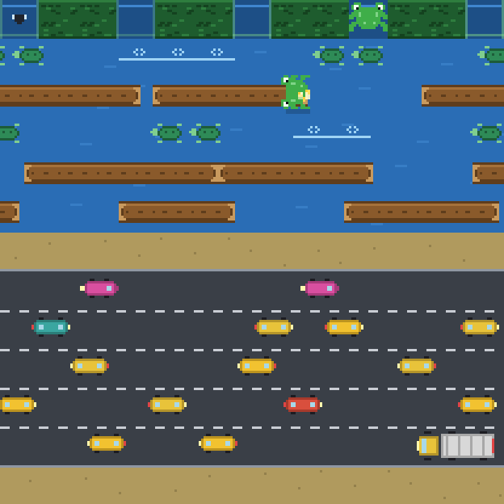
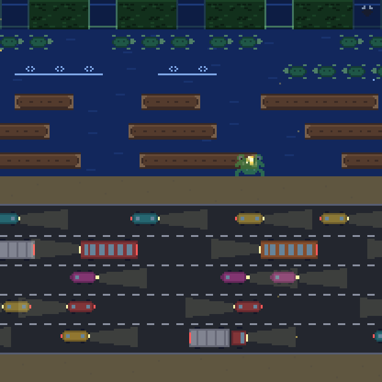

<div align="center">

# 🐸 froD

**لعبة أركيد حديثة: ساعد الضفدع على عبور الطريق والنهر**
*A modern frog-crossing arcade game — pure web platform, zero dependencies.*

[](#-الاختبارات--testing)
[](#)
[](#)
[](#)

 

</div>

---

## 🇸 العربية

### ما هذه؟
**froD** لعبة أركيد مستوحاة من الكلاسيكيات: تقود ضفدعًا من أسفل الشاشة إلى البيوت الخمسة في أعلاها، متجنبًا السيارات، وراكبًا الجذوع والسلاحف عبر النهر. لكن كل شيء فيها **مولّد برمجيًا**: الرسوم بكسل-آرت مرسومة بالكود، والموسيقى والمؤثرات الصوتية مُركّبة بـ WebAudio، والمستويات تُولّد ببذرة عشوائية — **بدون أي ملفات صور أو صوت، وبدون أي اعتماديات خارجية**.

### المميزات
- 🎮 **وضعان**: كلاسيكي لا نهائي + **تحدي اليوم** (نفس المسارات لكل اللاعبين، 5 مستويات).
- 🌗 **4 أوقات للنهار** تتناوب مع المستويات: نهار، غروب، ليل (مع أضواء السيارات واليراعات)، فجر.
- 🪵 جذوع وسلاحف تغوص، تيار يجرفك، ذباب مكافأة، درع ⭐ وساعة ⏱️.
- 🏆 أفضل النتائج، **14 إنجازًا**، إحصائيات مفصّلة، أرواح إضافية كل 10000 نقطة.
- 🌐 **عربي/إنجليزي** مع دعم كامل للاتجاه من اليمين لليسار.
- 📱 تعمل باللمس (سحب أو أزرار)، وبلوحة المفاتيح، واهتزاز على الجوال.
- 🤖 **ضفدع آلي** يلعب في الخلفية بالقائمة الرئيسية (ويُثبت أن المستويات قابلة للحل!).
- 📦 **PWA** تعمل دون إنترنت بعد أول زيارة.
- ⚙️ إعدادات: الصوت، الموسيقى، تقليل الحركة، تأثير CRT القديم.

### التحكم
| الإجراء | لوحة المفاتيح | اللمس |
|---|---|---|
| القفز | الأسهم أو `WASD` | اسحب بالاتجاه، أو أزرار الشاشة |
| قفزة للأمام | `مسافة` / `Enter` | نقرة سريعة |
| إيقاف مؤقت | `P` / `Esc` | زر ⏸ |
| كتم الصوت | `M` | — |

### التشغيل محليًا
```bash
node server.mjs        # أو: npm start
# ثم افتح http://localhost:3000
```
لا حاجة لتثبيت أي شيء — فقط Node 18+.

### الاختبارات
```bash
npm test               # 48 اختبارًا: المنطق، المستويات، الذكاء الآلي، تكامل التشغيل
npm run check          # فحص صياغة كل الوحدات
npm run icons          # توليد أيقونات PWA
npm run screenshots    # التقاط لقطات حقيقية من اللعبة (بلا متصفح!)
```

---

## 🇬🇧 English

### What is this?
**froD** is a classic-inspired arcade game: guide a frog from the bottom of the screen to the five homes at the top, dodging traffic and riding logs & turtles across the river. Everything is **procedurally generated**: the pixel-art is drawn in code, the music and SFX are synthesized with WebAudio, and levels come from a seeded RNG — **no image or audio files, and zero external dependencies**.

### Features
- 🎮 **Two modes**: endless Classic + a **Daily Challenge** (identical lanes for everyone, 5 levels).
- 🌗 **Four times of day** cycling with levels: day, dusk, night (headlights & fireflies), dawn.
- 🪵 Logs, diving turtles, a sweeping current, bonus flies, a ⭐ shield and a ⏱️ clock.
- 🏆 High scores, **14 achievements**, detailed stats, an extra life every 10,000 points.
- 🌐 **Arabic / English** with full RTL support.
- 📱 Touch (swipe or on-screen pad), keyboard, and mobile haptics.
- 🤖 An **autopilot frog** plays behind the main menu (and proves levels are solvable!).
- 📦 **PWA** — works offline after the first visit.
- ⚙️ Settings: SFX, music, reduce-motion, retro CRT effect.

### Controls
| Action | Keyboard | Touch |
|---|---|---|
| Hop | Arrows / `WASD` | Swipe, or on-screen pad |
| Hop forward | `Space` / `Enter` | Quick tap |
| Pause | `P` / `Esc` | ⏸ button |
| Mute | `M` | — |

### Run locally
```bash
node server.mjs        # or: npm start
# open http://localhost:3000
```
Nothing to install — just Node 18+.

### Testing
```bash
npm test               # 48 tests: logic, levels, autopilot, boot-and-play integration
npm run check          # syntax-check every module
npm run icons          # regenerate PWA icons
npm run screenshots    # capture real gameplay frames (no browser needed!)
```

---

## 🏗 Architecture

The codebase separates **pure logic** (Node-testable, no DOM) from **presentation** (browser):

```
src/
├── core/            # platform utilities (DOM-free unless noted)
│   ├── rng.js         seeded RNG (xmur3 + mulberry32)
│   ├── events.js      tiny event emitter with wildcards
│   ├── storage.js     localStorage with in-memory fallback
│   ├── i18n.js        ar/en dictionary, RTL-aware
│   ├── audio.js       WebAudio synth SFX + chip music sequencer
│   ├── input.js       keyboard + swipe + d-pad
│   └── particles.js   pixel particles, shake, flash
├── game/            # pure simulation
│   ├── constants.js   grid, timings, scoring
│   ├── level.js       deterministic procedural generation
│   ├── world.js       frog, conveyors, collisions, timer, pickups
│   ├── game.js        modes, score, lives, level flow (state machine)
│   ├── meta.js        stats, achievements, high scores
│   └── autopilot.js   heuristic bot (attract mode + solvability tests)
├── render/          # browser canvas
│   ├── sprites.js     procedural pixel-art, 4 theme palettes
│   └── renderer.js    world composition, frog animation, lights
├── ui/              # DOM
│   ├── hud.js         score / lives / time bar
│   ├── screens.js     menu, pause, scores, achievements, stats, settings…
│   └── style.css      cozy retro styling, RTL, responsive
└── main.js          # wiring + fixed-timestep loop
```

**Design notes**
- The world is a 13×13 grid; traffic and rivers are looping **conveyors** with guaranteed-crossable gaps.
- A coordinate convention keeps collision math and rendering pixel-aligned (see `renderer.js`).
- The game logic emits events; `main.js` maps them to audio, particles, HUD, persistence and achievements — so the engine stays testable in isolation.
- `scripts/lib/canvas2d.mjs` is a small **software rasterizer** that runs the real renderer headlessly to produce the screenshots above and in `docs/`.

See [`docs/ARCHITECTURE.md`](docs/ARCHITECTURE.md) for a deeper dive and [`docs/ROADMAP.md`](docs/ROADMAP.md) for what's next.

## 📜 License
MIT — see [`LICENSE`](LICENSE).

<div align="center">صُنعت بحب 💚 — Made with love</div>
